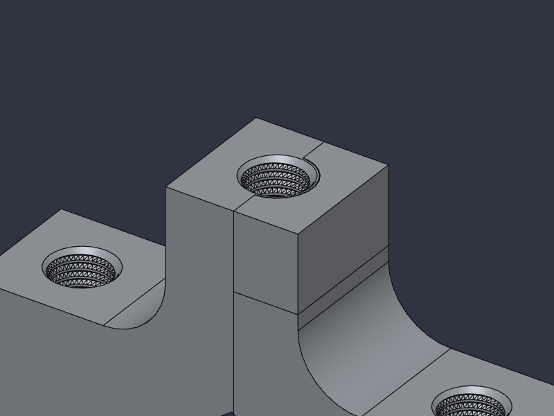
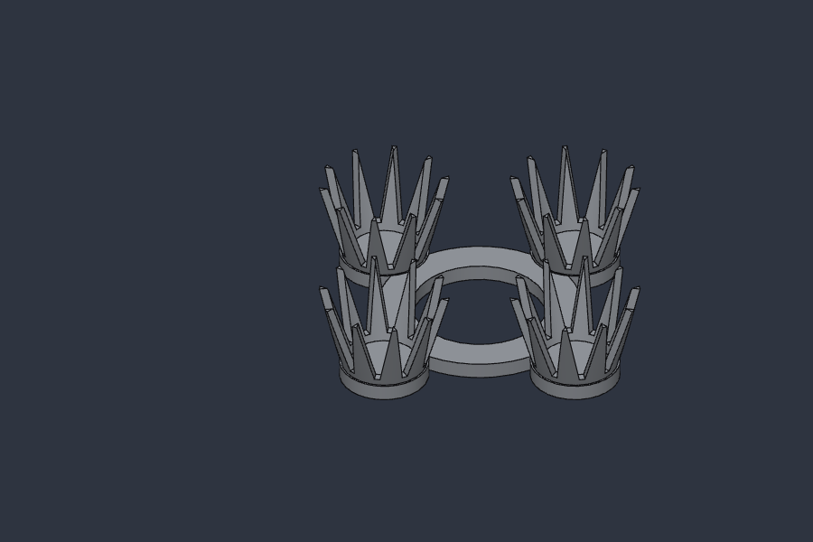
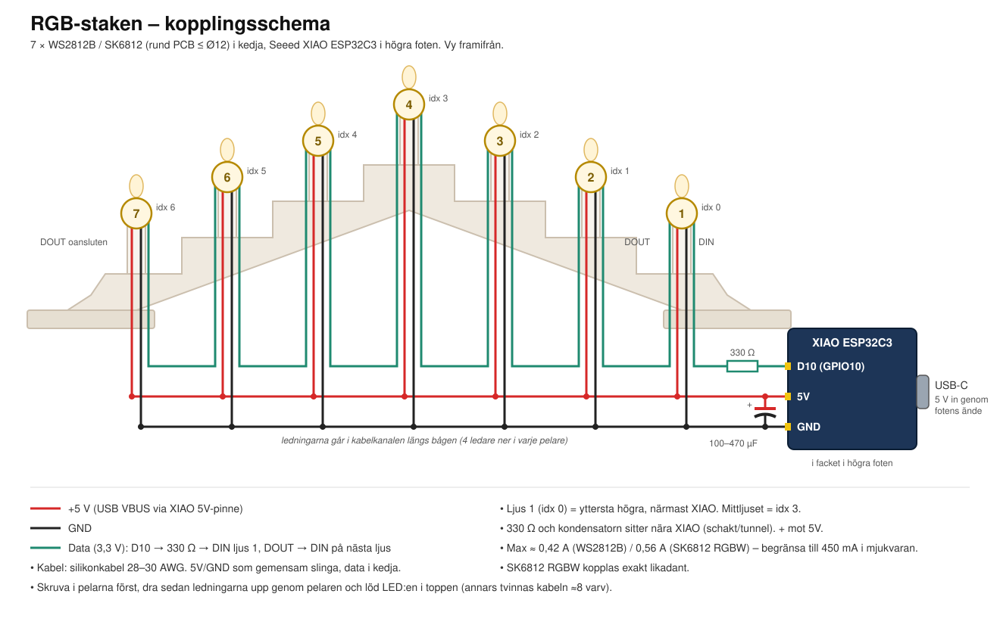

# RGB-staken

3D-printad adventsljusstake med 7 ljus och RGB-belysning (WS2812B/SK6812 + XIAO ESP32C3, WLED).

*Rendering (inte foto) i Blender Cycles. Staken är byggd av de riktiga STL-filerna i `stl/`, allt runt omkring är scenografi.
Rendera om med `blender -b -P bilder/render_scen.py -- <projektmapp> bilder/fonster_december.png 512`.
Renderingen är gjord före v2.4 (centrerad skarv, gängad låga, manschett).*

## Status (2026-11-14)

Aktuell version: **bas v2.6, pelare v2.2, låga v3, manschett v1.1**. Alla ändringar per version finns i
[CHANGELOG.md](CHANGELOG.md).

Senaste nytt:
- **Vågrät tunga i skarven (v2.5):** höger bashalva skjuts rakt in från höger, så locket och tungan går ihop i
  samma rörelse. **v2.6:** 0,5 mm spel i höjdled vid tungan och mittklossen (bredden har kvar 0,15 mm).
  Ta bort all support under tungan och mittklossen på vänster halva innan du trycker ihop halvorna.
- **Stift för pärlorna:** varje kopp i manschetten har ett stift (Ø2 × 2 mm) och pärlorna ett hål (Ø2,4 × 2,5 mm)
  i botten, så de hamnar mitt i koppen.
- **Centrerad skarv:** höger bashalva har ett lock över vänsters mittkloss, så skarven syns bara som en rak linje
  mitt på staken. På toppen rundar den mittljuset i en liten halvcirkel (döljs av manschetten).
- **Gängad låga:** lågan skruvas fast i pelarens topp med en M12×1-gänga (vanlig högergänga) med fasad nos och
  försänkt öppning. LED-kortet måste därför vara **högst Ø10 mm**.
- **Tillval – manschett:** en svart ring med fyra taggiga koppar och guldpärlor som träs över varje ljus.
- Antennslits för XIAO:ns WiFi-antenn och ett kondensatorfack i högra foten.

Provskrivet och klart: pelaren med gängad låga. Inte provskrivet än: v2.5-skarven och manschetten med pärlor.

## Mått

| | |
|---|---|
| c/c mellan ljusen | 50 mm |
| Steghöjd | 40 mm (plattor 180 / 140 / 100 / 60 mm) |
| Bågens öppning / topp | 300 mm vid fotens ovansida / 130 mm över golvet |
| Fötter | kloss 70 × 75 × 20 mm med avsats, total bredd 420 mm |
| Armänden | konkav utsvängning (R 28) ner mot foten, som på förlagan |
| Djup | 34 mm |
| Ljusrör | Ø16 mm, M16-gänga ner i basen |
| Låga | Ø15 × 39 mm, M12×1-gänga ner i pelaren |
| Ljusets topp | platta + 100 mm, alltså mitten 280 och ytterst 160 mm |

## Delar

| Del | Fil | Antal | Kommentar |
|---|---|---|---|
| Vänster bashalva | `base_left.stl` | 1 | Mittljusets hylsa (hel gänga), dold limtunga och mittkloss som höger halvas lock går över. Skrivs ut stående. |
| Höger bashalva | `base_right.stl` | 1 | Lock över mittklossen (2,5 mm gods, toppen bryggar 14 mm), XIAO-fack, antennslits, kondensatorfack, USB-C i foten. Skrivs ut stående. |
| Pelare (ljus) | `pillar.stl` | 7 | Ø16 × 61 mm synligt, M16-gänga 13 mm med konisk inledning nertill, M12×1-hylsa med försänkning upptill, kabelhål Ø7, LED-urtag Ø12,4. |
| Låga | `flame.stl` | 7 | Räfflad kupa Ø15 × 39 mm, gängad tapp M12×1 med fasad nos och Ø8 ljushål. Transparent/natural PETG, 0 % fyllning. |
| Locklist | `channel_lid.stl` | 2 | 185 × 15,7 × 2,3 mm, täcker kabelspåret i bågens undersida. Skrivs ut liggande. |
| Manschett (tillval) | `cuff.stl` | 7 | Ring Ø16,6 inuti med fyra koppar à 10 taggar, Ø48 över allt, stift Ø2 × 2 mitt i varje kopp. Svart, liggande, inget support. |
| Pärla (tillval) | `bead.stl` | 28 | 9 × 11 mm ägg med platt botten och hål Ø2,4 × 2,5 för stiftet, limmas i manschettens koppar. Guld silk-PLA, stående på botten. |

CAD-filer (SolidCraft) finns i `solidcraft/`: `bas.sc`, `pelare.sc`, `lagan.sc`, `lock.sc`, `manschett.sc`, `parla.sc`.

## Montering

1. **Basen:** skjut höger halva **rakt in från höger** (vågrätt). Locket går då över vänsters mittkloss samtidigt
   som den dolda, vågräta tungan (20 × 18 mm, 13,5 mm lång) går in i spåret i höger halva. Allt har 0,15 mm
   limspel. Tryck ihop och limma.
2. **Antenn och XIAO:** skjut in WiFi-antennen snett underifrån i antennslitsen i högra armen, lägg sedan XIAO:n i
   facket (USB-C ut genom fotens ände) och kondensatorn i facket bredvid.
3. **Pelarna:** skruva ner pelarna i basens M16-hylsor tills rörets kant tar stopp i hylsans försänkning.
   Skruva i pelarna *innan* LED:en löds, annars tvinnas kabeln.
4. **Kablar och LED:** lägg kablarna i det öppna spåret i bågens undersida och ner genom rännan under högra foten.
   Trä dem upp genom pelarna och löd LED:en i toppen (se [`elektronik/`](elektronik/README.md)).
5. **Locklister:** tryck in dem i falsen (16 × 3 mm) och fäst med några droppar lim eller smältlim.
6. **Tillval:** trä manschetten över pelaren (går även med lågan på) och limma i pärlorna – hålet i pärlans botten
   träs på stiftet i koppen.
7. **Lågorna:** skruva fast dem medurs i pelarnas topp.

## Elektronik

- 7 × WS2812B eller SK6812 RGBW på rund PCB (**≤ Ø10 mm**), en i toppen av varje pelare.
- XIAO ESP32C3 matas via USB-C, LED:erna från 5V-pinnen (≈ 0,4 A max).
- ~330 Ω på data, ~470 µF över 5V/GND. Mjukvara: WLED eller ESPHome.

Kopplingsschema, dragning i basen och färdig konfiguration för WLED och ESPHome finns i
[`elektronik/`](elektronik/README.md).

## Licens

Allt i repot (CAD-filer, STL, kod, konfiguration och bilder) är släppt som
[CC0 1.0 Universal](LICENSE), alltså fri allmän egendom. Du får ladda ner, ändra, sprida och använda
materialet precis som du vill, även kommersiellt, utan att fråga och utan att ange källa.
