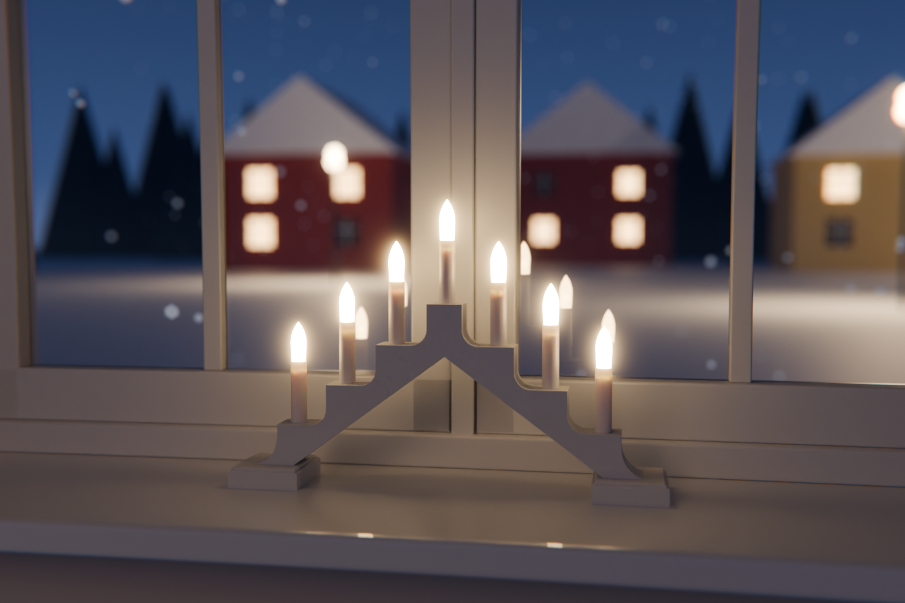
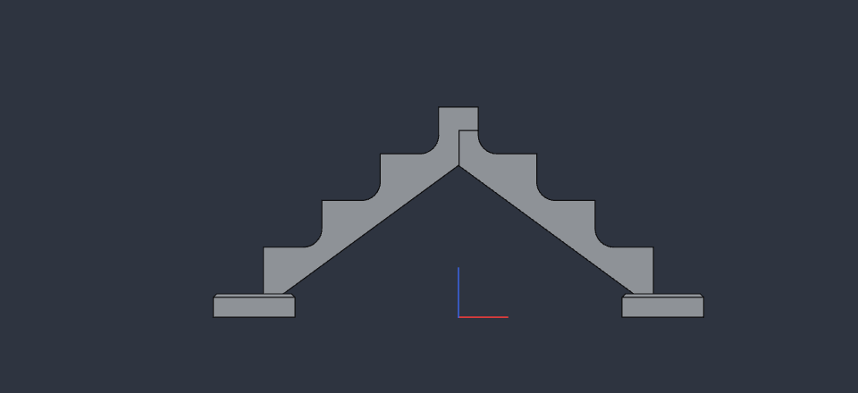

# RGB-staken

3D-printad adventsljusstake med 7 ljus och RGB-belysning (WS2812B/SK6812 + XIAO ESP32C3, WLED).

*Rendering (inte foto) i Blender Cycles. Staken är byggd av de riktiga STL-filerna i `stl/`, allt runt omkring är scenografi.
Rendera om med `blender -b -P bilder/render_scen.py -- <projektmapp> bilder/fonster_december.png 512`.*

## Status (2026-11-08)

Alla delar är uppdaterade till v2 (uppmätta mått) och STL-filerna i `stl/` är nya:
`base_left.stl`, `base_right.stl`, `pillar.stl` (skriv ut 7) och `flame.stl` (skriv ut 7).
Nästa steg är en provutskrift av en pelare och en hylsa för att kontrollera gängspelet.

## Mått (v2)

| | |
|---|---|
| c/c mellan ljusen | 50 mm |
| Steghöjd | 40 mm (plattor 180 / 140 / 100 / 60 mm) |
| Bågens öppning / topp | 300 mm vid fotens ovansida / 130 mm över golvet |
| Fötter | kloss 70 × 75 × 20 mm med avsats, total bredd 420 mm |
| Armänden | konkav utsvängning (R 28) ner mot foten, som på förlagan |
| Djup | 34 mm |
| Ljusrör | Ø16 mm, M16-gänga ner i basen |
| Ljusets topp | platta + 100 mm, alltså mitten 280 och ytterst 160 mm |

## Delar

| Del | Antal | Kommentar |
|---|---|---|
| Vänster bashalva | 1 | Med mittblocket (ovanför z 160) och limtungan, 240,5 mm. Skrivs ut stående. |
| Höger bashalva | 1 | XIAO-fack + USB-C i foten, 209,5 mm. Skrivs ut stående. |
| Pelare (ljus) | 7 | Ø16 × 61 mm synligt, M16-gänga 16 mm, kabelhål Ø7 (Ø6 i gängan), LED-urtag Ø12,4 × 9. |
| Låga | 7 | Räfflad kupa Ø15 × 39 mm + tapp Ø12, transparent/natural PETG, 0 % fyllning. |

CAD-filer (SolidCraft) finns i `solidcraft/`: `bas.sc`, `pelare.sc`, `lagan.sc`.

## Montering

- Bashalvorna trycks ihop i mitten och limmas. En dold tunga (20 mm bred, 0,15 mm limspel)
  från vänster halva går in i ett spår i höger.
- Pelarna skruvas ner i basens M16-hylsor tills de bottnar.
- Kablarna går i en invändig kanal längs bågen och ner till XIAO-facket i högra foten.

## Elektronik

- 7 × WS2812B eller SK6812 RGBW på rund PCB (≤ Ø12 mm), en i toppen av varje pelare.
- XIAO ESP32C3 matas via USB-C, LED:erna från 5V-pinnen (≈ 0,4 A max).
- ~330 Ω på data, ~470 µF över 5V/GND. Mjukvara: WLED eller ESPHome.

Kopplingsschema, dragning i basen och färdig konfiguration för WLED och ESPHome finns i
[`elektronik/`](elektronik/README.md).

## Licens

Allt i repot (CAD-filer, STL, kod, konfiguration och bilder) är släppt som
[CC0 1.0 Universal](LICENSE), alltså fri allmän egendom. Du får ladda ner, ändra, sprida och använda
materialet precis som du vill, även kommersiellt, utan att fråga och utan att ange källa.
