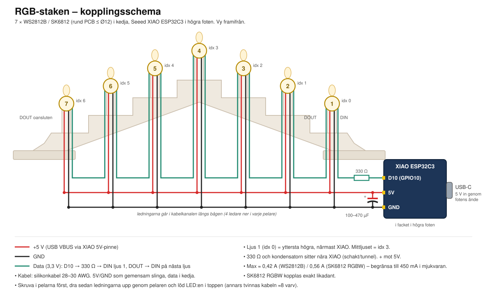

# Elektronik – RGB-staken

## Komponenter

| Del | Antal | Kommentar |
|---|---|---|
| Seeed XIAO ESP32C3 | 1 | I facket i högra foten, USB-C ut genom fotens ände. Glöm inte den medföljande WiFi-antennen (se nedan). |
| WS2812B på rund PCB ≤ Ø12 mm, **eller** SK6812 RGBW (rekommenderas, varmare vitt) | 7 | En i toppen av varje pelare, i urtaget Ø12,4. |
| Motstånd 330 Ω (0805 eller ¼ W) | 1 | I dataledningen, nära XIAO. |
| Kondensator 100–470 µF, 6,3–10 V | 1 | Över 5V/GND nära XIAO. Låg modell (t.ex. 6,3 × 5 mm SMD-elektrolyt) får plats i rännan under foten. |
| Silikonkabel 28–30 AWG, röd/svart/grön | ≈ 3 m av varje | 4 ledare ner i varje pelare. |
| USB-C-kabel + 5 V-laddare ≥ 1 A | 1 | |

## Koppling

| XIAO-pinne | Till |
|---|---|
| **D10** (GPIO10) | 330 Ω → **DIN** på ljus 1 |
| **5V** | +5V på alla LED (gemensam slinga) + kondensatorns plus |
| **GND** | GND på alla LED + kondensatorns minus |

Dataledningen går i kedja: **DOUT** på ljus *n* → **DIN** på ljus *n + 1*. DOUT på ljus 7 lämnas oansluten.

Ordning (data­riktning från XIAO och åt vänster, sett framifrån):

| Ljus | 1 | 2 | 3 | 4 | 5 | 6 | 7 |
|---|---|---|---|---|---|---|---|
| Index (WLED/ESPHome) | 0 | 1 | 2 | 3 | 4 | 5 | 6 |
| Position | höger ytter | | | **mitten** | | | vänster ytter |
| Plattans höjd | 60 | 100 | 140 | 180 | 140 | 100 | 60 mm |

Varför D10? Den sitter bredvid 5V/GND/3V3 på XIAO:n och är ingen strapping-pinne (GPIO2, 8 och 9 är det och påverkar uppstarten).

### Dragning i basen

Kanalen är öppen nedåt (spår i bågens undersida + ränna under högra foten), så allt dras med staken liggande
på rygg eller sidan.

1. Lägg en slinga röd (5V) och svart (GND) i spåret längs bågen, ner genom rännan under högra foten till XIAO-facket.
2. Skruva i pelarna **först**. Trä sedan ledningarna upp från spåret genom Ø8-hålet i hylsbotten och kabelhålet i
   pelaren (Ø7, Ø6 genom gängan) och löd LED:en i toppen. Löder man först tvinnas kabeln ≈6 varv när pelaren skruvas ner.
3. Varje pelare får fyra ledare: 5V, GND, DIN (från föregående ljus/XIAO) och DOUT (till nästa ljus).
   5V och GND skarvas mot slingan i spåret (krympslang!).
4. Testa varje LED innan lågan trycks på – med WLED eller ESPHome syns direkt vilken som inte svarar.
5. WiFi-antennen (flex-PCB) läggs platt mot facket/rännans vägg. Utan antenn är räckvidden mycket dålig.
6. Tryck in locklisterna i falsen i bågens undersida och fäst dem med några droppar lim eller smältlim.

### Ström och signalnivå

- 7 × WS2812B drar som mest ≈ 0,42 A (vitt, full ljusstyrka), SK6812 RGBW ≈ 0,56 A. USB-porten och XIAO:ns 5V-pinne
  klarar det, men sätt ändå en strömgräns på **450 mA** i WLED. I praktiken lyser staken med 10–30 % av det.
- XIAO ger 3,3 V data och LED:erna kräver formellt 0,7 × 5 V = 3,5 V. Med kort ledning och 330 Ω fungerar det nästan
  alltid. Blinkar ljus 1 fel/slumpmässigt: sätt en diod (1N4148/1N5819) i 5V-matningen till **bara ljus 1**
  (då sjunker dess VDD till ≈4,3 V och 3,3 V räcker), eller använd en nivåomvandlare (74AHCT1G125).

## Mjukvara – välj en

### A. WLED (enklast, app i mobilen)

1. Gå till <https://install.wled.me> i Chrome/Edge, anslut XIAO:n med USB och välj **ESP32-C3**-versionen.
   (Syns inte kortet: håll BOOT intryckt när USB-kabeln sätts i.)
2. Anslut till WiFi-nätet `WLED-AP` (lösenord `wled1234`) och ange ditt hemnätverk.
3. **Config → LED Preferences**
   - *Maximum Current*: 450 mA, *LED voltage*: 5V default (55 mA)
   - *LED output 1*: typ **WS281x** (eller **SK6812/WS2814 RGBW**), färgordning **GRB**, *Length* **7**, *GPIO* **10**
   - RGBW: *Auto-calculate white channel* = **Accurate**
   - Spara.
4. **Config → Security & Updates → Restore presets**: ladda upp [`wled/presets.json`](wled/presets.json).
   Förinställningar: 1 Varmvitt, 2 Stearinljus (Candle Multi), 3 Eldsken (Fire Flicker), 4 Julfärger (röd/grön
   varannan), 5 Regnbåge, 6 Nattljus.
5. Valfritt: **Config → WiFi Setup** → mDNS-namn `rgbstaken`. **Config → Time & Macros**: tidszon CET/CEST,
   latitud/longitud, och en timer som startar preset 2 vid solnedgång och släcker 23:00.

WLED syns automatiskt i Home Assistant (WLED-integrationen) och i WLED-appen.

### B. ESPHome (för Home Assistant)

Konfiguration: [`esphome/rgbstaken.yaml`](esphome/rgbstaken.yaml)

1. Kopiera `esphome/secrets.yaml.example` till `esphome/secrets.yaml` och fyll i (filen checkas inte in).
2. `esphome run esphome/rgbstaken.yaml` med XIAO:n i USB första gången, sedan trådlöst.
3. SK6812 RGBW: byt `chipset` till `SK6812` och lägg till `is_rgbw: true` (står kommenterat i filen).

Ger en lampa *Staken* med effekterna Levande ljus (varje ljus fladdrar för sig), Flimmer, Glitter, Regnbåge,
Julfärger och Andas, plus sju egna lampor *Ljus 1–7* för att styra varje ljus separat. Längst ner finns ett
avstängt exempel för att tända 15:30 och släcka 23:00 utan Home Assistant. Webbsida på `http://rgbstaken.local`.
